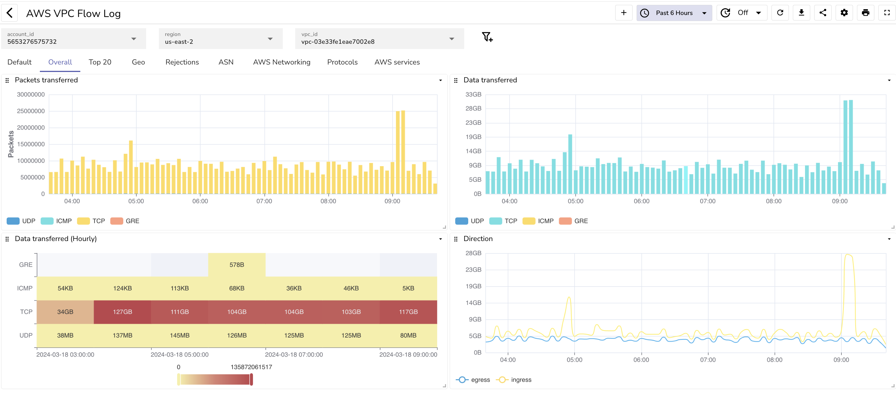
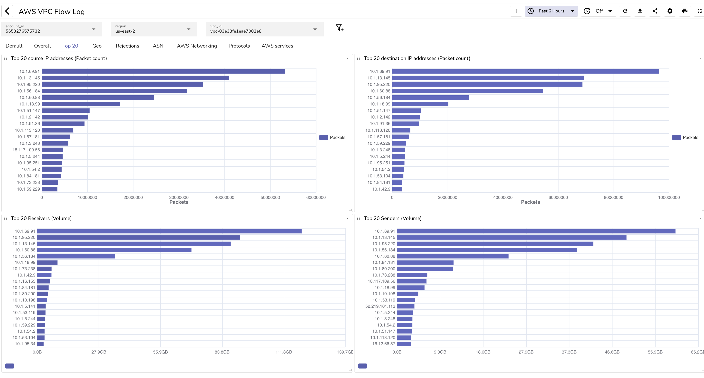
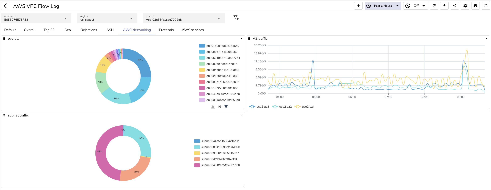
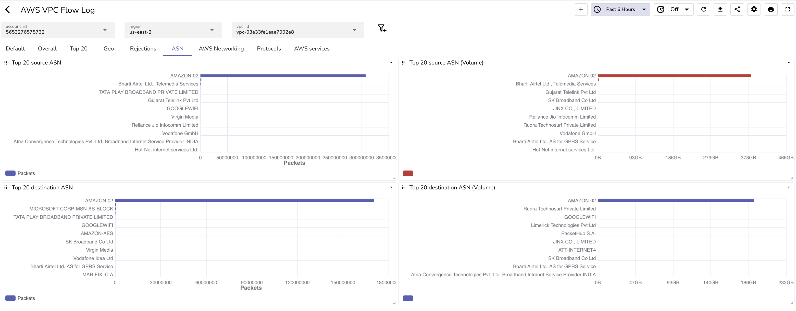
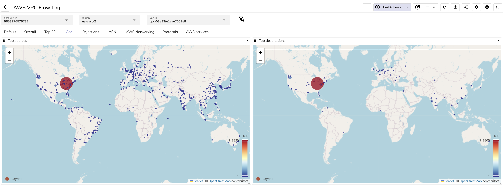
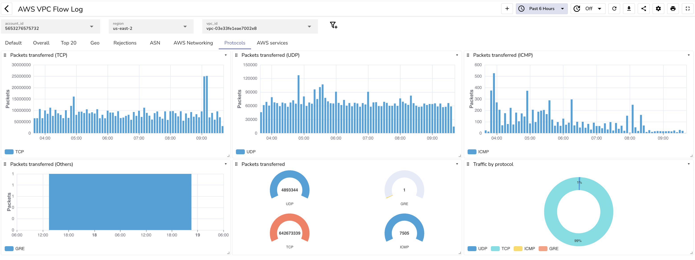
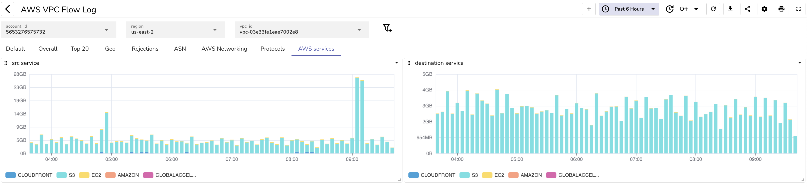
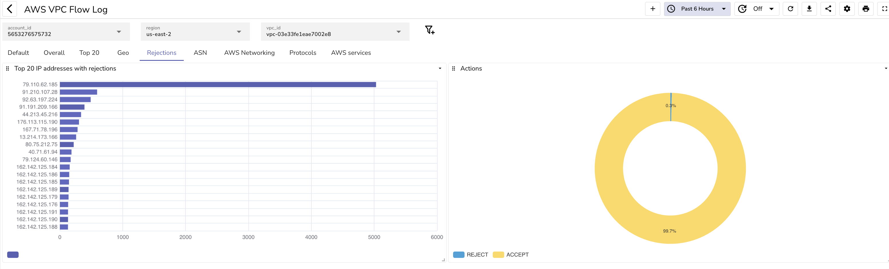

# AWS VPC Flow log

Visualize AWS VPC Flow logs in Owlpane. In order to understand how to set this up, please refer to the [Owlpane blog on AWS VPC flow log](https://owlpane.ai/docs).

## High level info

## Top 20

## AWS networking

## ASN details

## Geo details

## Protocol details

## AWS Services

## Rejected traffic

