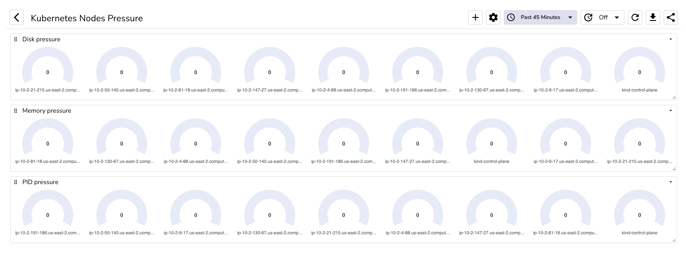
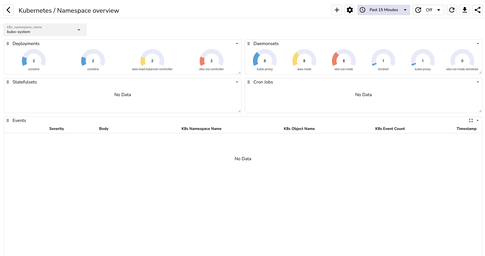
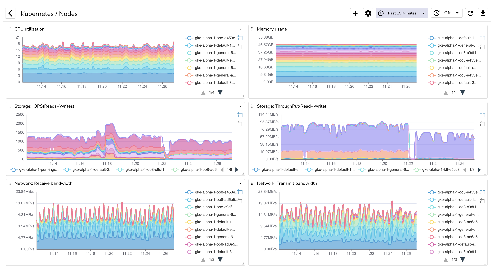
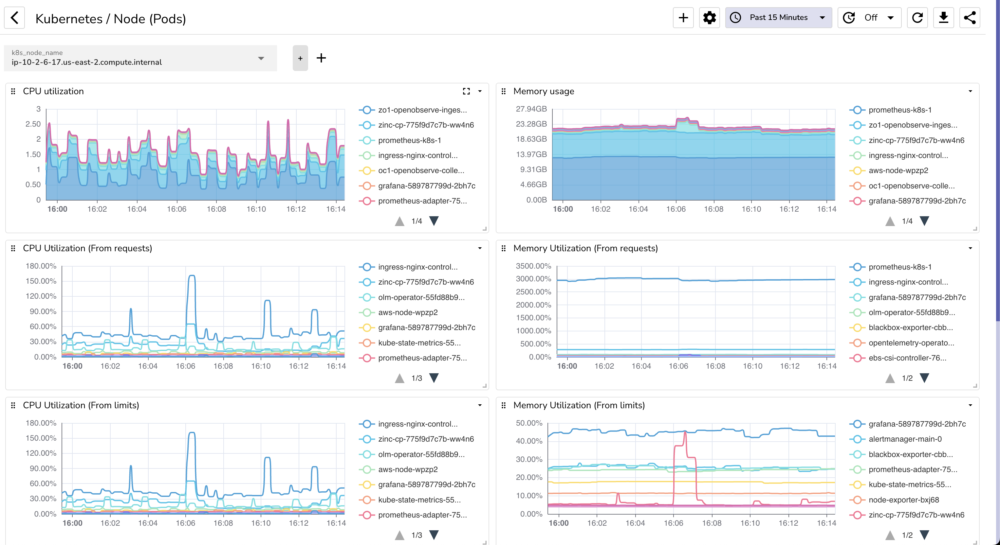
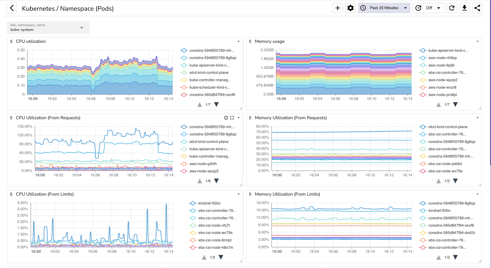
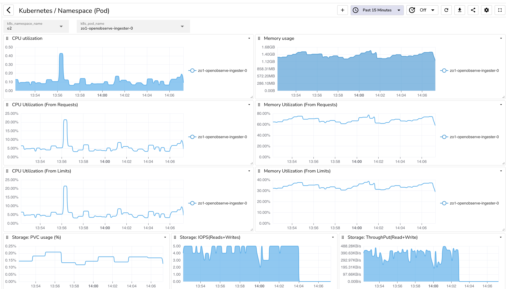
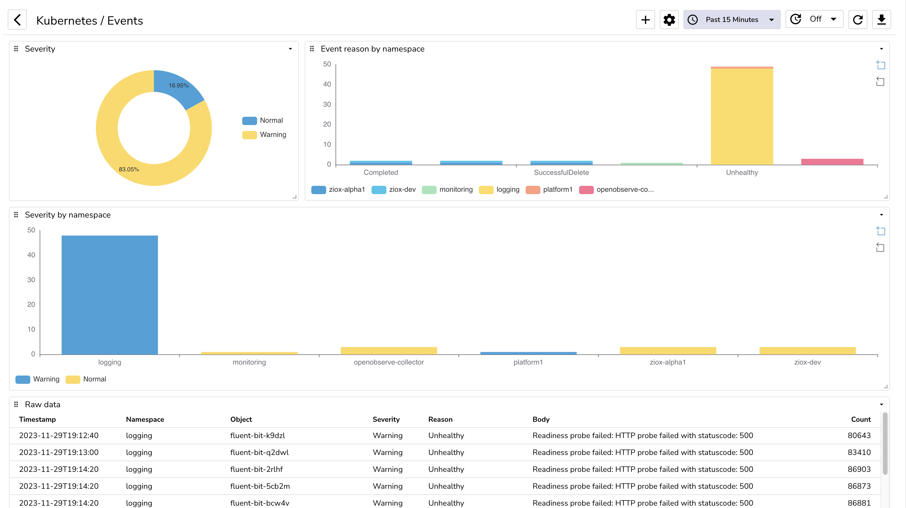

# Kubernetes dashboards

This folder contains Kubernetes dashboards for Owlpane. These are built on top of data collected by owlpane-otel-collector (otel-collector configured to collect Kubernetes metrics specifically for Owlpane). Check configuration at https://github.com/OwlPane/owlpane-agent

## Nodes (Pressure)

 

## Namespace overview

 

## Nodes

 

## Node (Pods)

 

## Namespace (Pods)

 

## Namespace (Pod - Just 1 pod)

 

## Events

 

