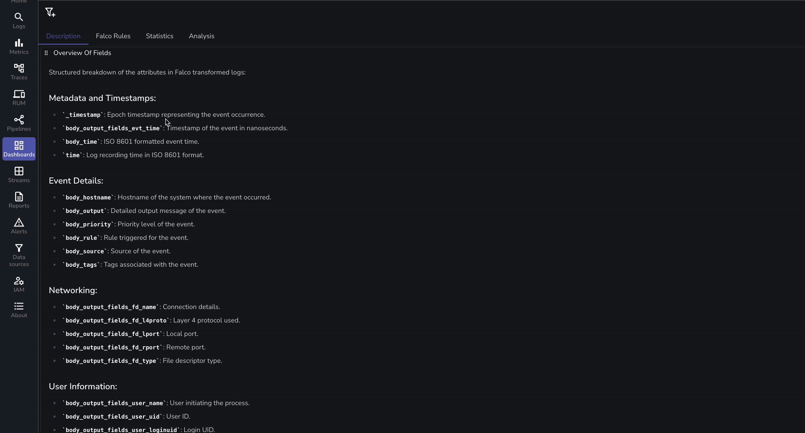

# Falco Security Monitoring Dashboard

This repository contains a JSON file for a comprehensive Falco Security monitoring dashboard on Owlpane. By importing this dashboard, you gain immediate visibility into critical insights, helping you monitor and protect Kubernetes clusters against runtime threats.

## Dashboard Features
The JSON file includes panels covering various essential metrics, such as:

- Threat Detection and Severity Levels
- Kubernetes Cluster Insights
- User Activity Analysis
- Network Activity Monitoring
- Container and Application Security
- Falco Rule Monitoring
- Resource Access Trends
- System Calls and Process Monitoring
- Policy Compliance Metrics
- Event Timeline View

## Using Falco with Owlpane's own findings

This export reads raw Falco log fields (`body_rule`, `body_output`) that Owlpane's log SQL does not produce, so most of its panels need data shaped like the original source.

If you send Falco (or Tetragon) through the agent's `security-bridge`, use the [Runtime security](../runtime_security/README.md) dashboard instead. It is built on the findings the bridge writes and works as soon as the first one arrives.
